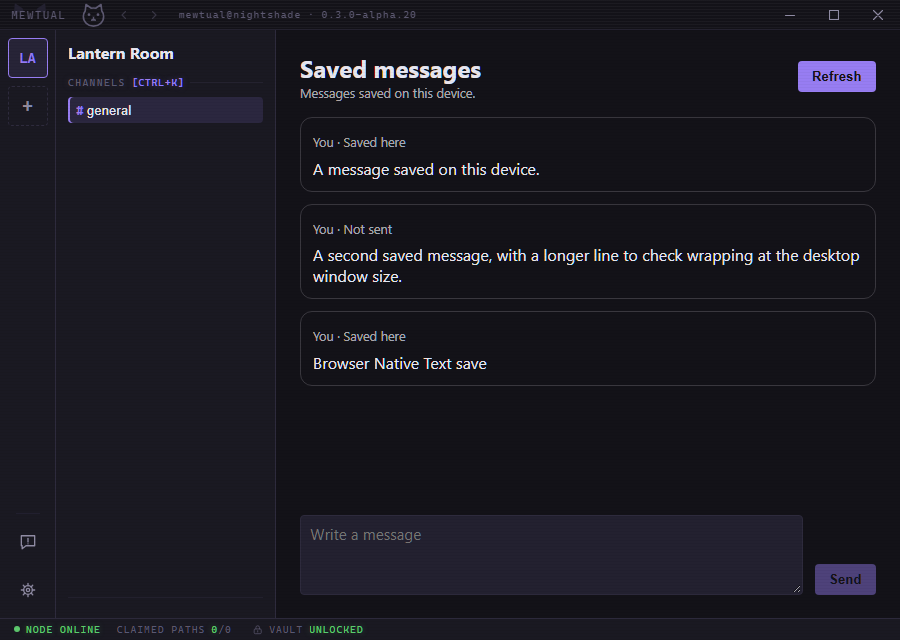
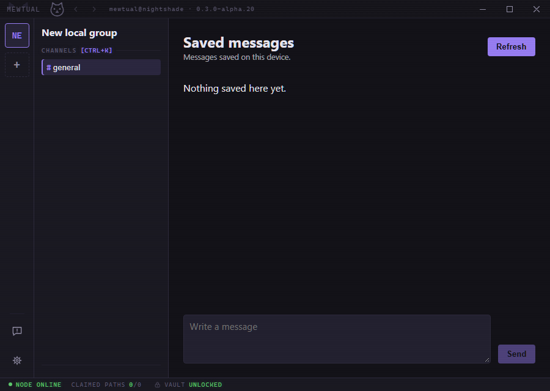

# Native Text session and local-message UI

Chat V2 is OFF. This increment connects warm native session restoration,
group creation, ordinary local saves and the saved-original reader to the real
App. It does not implement communication with a second member.

## Native boundary

Native unlock/resume returns a closed `text-v2` envelope, including when its
server list is empty. Legacy continues returning its existing array. A native
row contains the actual installed context, primary channel and display labels;
these are correlation data, never command credentials. The original successful
authentication check survives through listing and final reply validation.
Final publication checks the exact mounted facade, generation, complete row
set, original selections/incarnations and account/entry cancellation. Insertion
into a previously empty set and replacement by a live same-generation object
both make the old response stale.

Unlock and resume share two independently charged listing slots. Each owns
eight actual 4096-byte UI metadata credits before buffer allocation and keeps
them through whole-output destruction. The serializer caps its result at
16 KiB. Listing does not capture a Source, SDK loan or physical worker. This is
an application-accounting claim, not a bound on allocator, IPC or WebView RSS.
The Root debit quote is exposed as policy data only.

A Busy/stale listing after authentication must not consume an outstanding
warning acknowledgement. Warn is published only with its original error;
Ack only with a validated successful native response. Both are rechecked
against the exact current Store receipt, target and generation at publication.

## Renderer behavior

The App retains backend mode separately from its server list, so an empty
native response cannot downgrade to Legacy. The disabled native entry screen
offers local group creation only. Unsupported Join, DM, server settings,
surface navigation and Legacy background readers are excluded centrally.

The native request driver writes an exact critical4 intent before invoking
native creation or send. Retries retain the original 32-byte token, context,
body and resolved creation settings. A failed seal invokes no authoring
command; an uncertain reply or failed journal cleanup keeps the same intent.
The real retry scheduler includes this separate native journal. Its owner is
bound to the UI generation, so an old completion cannot clear a newer retry.

Composer retirement occurs after sealing and checks the original context,
draft revision and exact text, including automatic recovery. A user edit made
during the seal survives. A recovered first group opens only if the original
empty-view navigation still owns the screen. Reads and writes exclude each
other; after a write retires, its owner reads the latest selected view even
when navigation changed during the write.

`NativeSavedChat` explicitly displays **messages saved on this device**. It
does not feed Legacy totals, unread markers or peer receipts. Decimal-string
u64 ordinals preserve exact cursors. Empty channel-filtered pages continue
under the same fixed context-wide end; a batch stops after16 pages/128 items.
Loading, read failure, partial continuation and complete emptiness are distinct
states. This is an own-original list, not the final shared chat projection.

## Verification and remaining scope

All83 native-text cases passed, including real two-row restoration,
lock/reauthentication, live replacement, warning custody, responder panic and
lost observer. The actual post-body/proof destructor observation verifies
payment remains live and UI/Store/table guards are available. The Root quote
regression passed. Native strict Clippy and explicit native check passed.

The final full frontend suite passed3480 tests with no skips (70.47s). Static checking
reported0 errors/warnings; the production build passed. Adversarial review found
and fixed retry ownership, composer duplication, unsupported startup/reactive
reads and read/write overlap. Native browser/effect flows passed for restoration,
exact-intent seal-before-send, new local saves and first-group creation. The
existing browser QR/send/search/friend/recovery/boot flows also passed. Final
native build/startup passed; startup used the pre-existing development server
on1420 and proves setup completion, not exact frontend/native physical acceptance.
Exact-head complete Root/native CI is still pending at this checkpoint.
Root strict Clippy remains blocked by the same564 inherited errors;
both dependency audits, formatting, ambient-dependency and raw-fs gates passed.

The localhost development fixture has a separate Native Text mode, strict
server-command refusal, local-save-only replies and real decoder tests. It
does not authenticate native commands. The real browser gate runs this mode
at900×640 and separately exercises empty-vault creation.

Still required: joined-member/Add sources, shared projection and admin audit,
V2 record/original delivery and recovery, scalable durable governing archive,
cold operational authoring restore, usable Leave/Retired and multi-member
epoch/restart/bubble/load acceptance. Legacy projection event listeners remain
mode-blind; current Native producers emit none, and future event integration
must isolate those callbacks before enabling them. UI continuity alone does
not recover a cold signer or establish peer delivery.
